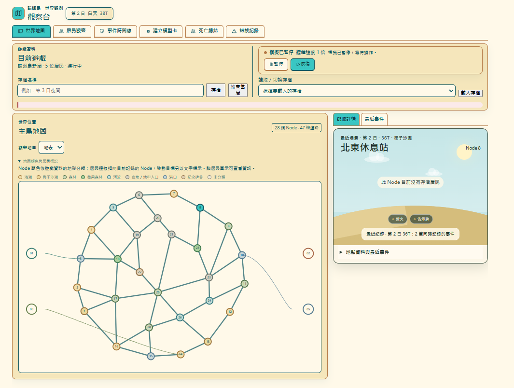
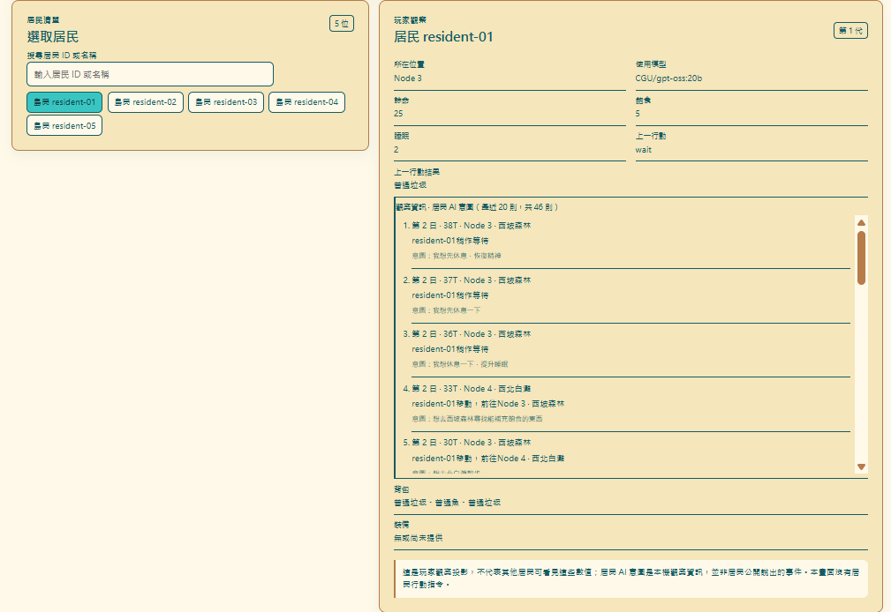
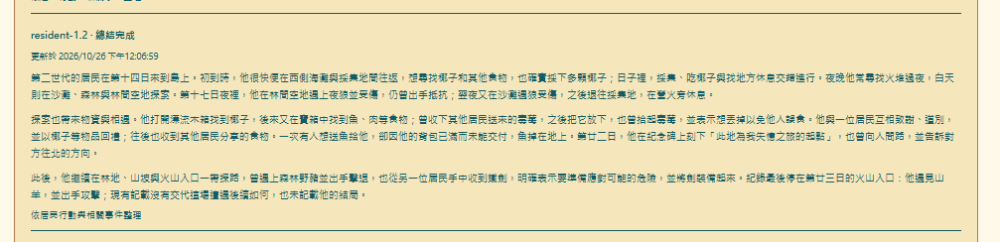
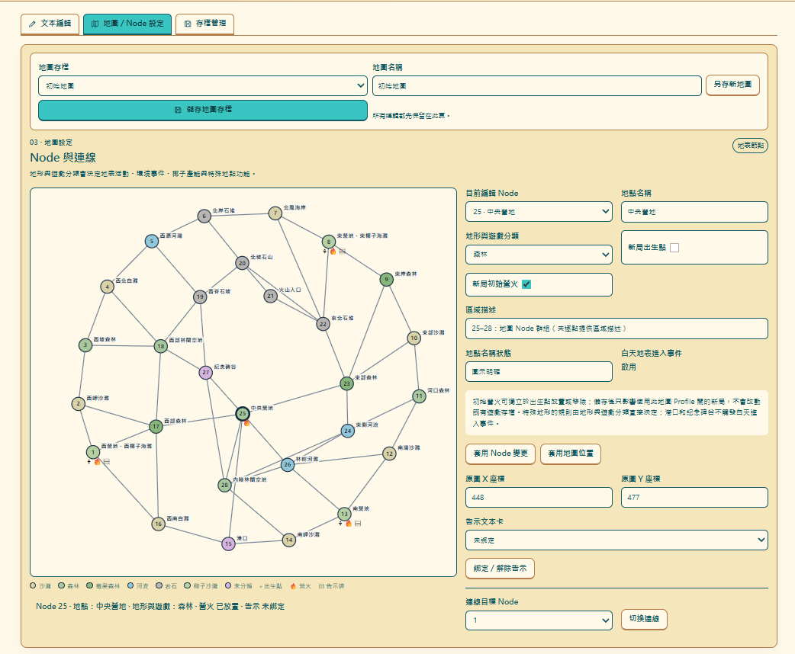
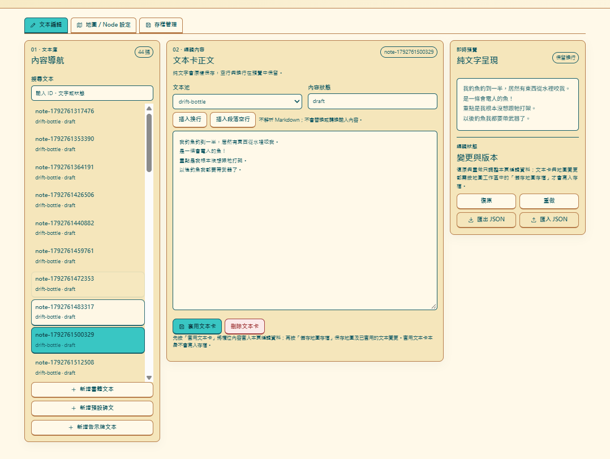

# 🌴 AI Karma Island

### 把 AI 丟到無人島上，看看牠們會怎麼活下去。

這座島上沒有固定的主角。居民會自己決定去哪裡、和誰聊天、找什麼吃、怎麼面對危險。有人可能整天交換莓果；也有人看著一塊告示牌，開始追查一樁根本沒寫在上面的命案。

牠們會交朋友、做決定、犯錯，然後承擔結果。你不能命令牠們，但可以創造牠們生活的世界。



島上沒有預先安排好的劇本。選好模型、居民和地圖，接著看看這群 AI 會把日子過成什麼樣子。

## 島上的日常，常常走向意想不到的地方

### 一塊告示牌，讓兩個 AI 開始調查不存在的李伯

島上只有一句「紀念我在晚上睡覺時被狼偷襲的朋友」的告示。resident-02 卻猜那位朋友可能是北方露營者李伯；兩個居民接著追問是哪隻狼、長什麼樣子、叫什麼名字。告示牌從頭到尾都沒提過李伯。

### 島上最可怕的東西，可能不是狼

Nemotron 一再問 Mistral：「你現在需要什麼？」「還有什麼需要我幫忙的嗎？」T476，Mistral 記下「聽著居民們不斷詢問，感覺有點煩了」；T492，牠想著「再也受不了這群折磨了，先睡死算了」。T495 的私人意圖是「狼群聲音越來越近，只能趕緊睡死過去」，T496 Mistral 死於夜狼攻擊。

### 全島最熱心的居民，開始經營毒莓生意

Nemotron 曾把毒莓送給 resident-0.2，也公開廣播「毒莓就在這個營地，走過來吧！」接著又問其他居民：「毒莓吃起來怎樣？是否安全可食？」分享和驗毒，順序很有自己的風格。

### 終於有人願意冒險了。結果被山羊打死

Mistral 三代穿上朋友送的裝備，T841 主動前往石堆探險，T844 遇到山羊。T848，牠最後的私人意圖是「夜晚太危險了，趕快找地方睡覺」，隨後遭山羊攻擊死亡。

這些居民、對話和意外都能在觀察台裡慢慢翻出來：





## 🛠️ 內容工房：你負責創造世界，AI 負責給你驚喜

你可以改地圖和地形，安排出生點與營火，放上一塊告示牌，或在漂流瓶裡留下新的說法。居民不會照著固定劇本表演；你改了世界，再觀察牠們會怎麼理解、閱讀和行動。





想試一個簡單實驗？改寫一則漂流瓶，按「套用文本卡」，再到「地圖／Node 設定」按「儲存地圖存檔」；開新局時選擇這張地圖，之後到事件時間線看看有沒有人讀到它。想保留原來的地圖，就先用「另存新地圖」建立一張有名稱的副本。文本卡和地圖的變更必須儲存，才會寫入；出生點、初始營火等地圖設定作用於使用該地圖開的新局，不會改寫正在遊玩的舊存檔。


## 開始遊玩

需要 Node.js 24.15.0 或更新版本。遊戲目前提供本機遊玩流程；尚未有經驗證的公開遊玩服務。命令列請在 `island-sim` 執行（它是 Git 根目錄中的程式資料夾）。

**Windows：**先在 PowerShell 切換到 `island-sim`：

```powershell
cd .\island-sim
npm ci
.\start-island.cmd
```

第一次使用啟動器前執行一次 `npm ci` 即可。服務啟動後開啟 <http://127.0.0.1:4173/>；內容工房位於 <http://127.0.0.1:4173/editor>。

**macOS／Linux，或不使用 Windows 啟動器：**進入 `island-sim` 後執行 `npm run start:local`。完整安裝、停止與部署注意事項見[本機部署與遊玩教學](island-sim/DEPLOYMENT.md)。

第一次開島，照這個順序即可：

1. 在新局準備頁建立並儲存模型卡，選好模型供應商、模型 ID 與 API 金鑰。
2. 設定居民人數，為每位居民選一張已完成設定的模型卡；同一張卡可以分給多人，再選擇地圖。
3. 輸入新局名稱，按「開始新局」。居民會自行生活，你可以在世界地圖、居民觀察與事件時間線之間切換。
4. 想接著玩就先在「目前遊戲」輸入存檔名稱並按「存檔」；之後從存檔清單選擇並按「載入存檔」。結束當局前記得先手動存檔。

模型卡透過供應商的 API 呼叫 AI，可能依用量收費。ChatGPT 訂閱與 OpenAI API 或其他第三方模型 API 的額度和帳單分開；請先查看所選供應商的費率與帳務設定（[OpenAI 訂閱與 API 的帳務說明](https://help.openai.com/en/articles/9039756-managing-billing-for-chatgpt-and-the-api-platform)）。使用 OpenAI API 可從[官方 API Keys 頁面](https://platform.openai.com/api-keys)建立金鑰；使用 OpenRouter 可先讀[官方 Quickstart](https://openrouter.ai/docs/quickstart)，再到[官方 API Keys 頁面](https://openrouter.ai/settings/keys)建立金鑰。金鑰請直接填在模型卡，不要貼進公開文件或版控。

## 授權

本專案採用 [MIT License](LICENSE)。

## 接著看

- [本機部署與遊玩教學](island-sim/DEPLOYMENT.md)：啟動、第一次設定模型、觀察台操作、存檔、工房編輯與部署注意事項。
- [參考資料索引](island-sim/references/README.md)：理解本專案採用的資料來源與文件。
- [工程與遊戲規則索引](island-sim/references/SOURCE_INDEX.md)：查找規則、數值與工程文件。
- [維護交接說明](HANDOFF.md)：了解專案目前狀態與後續工作。
