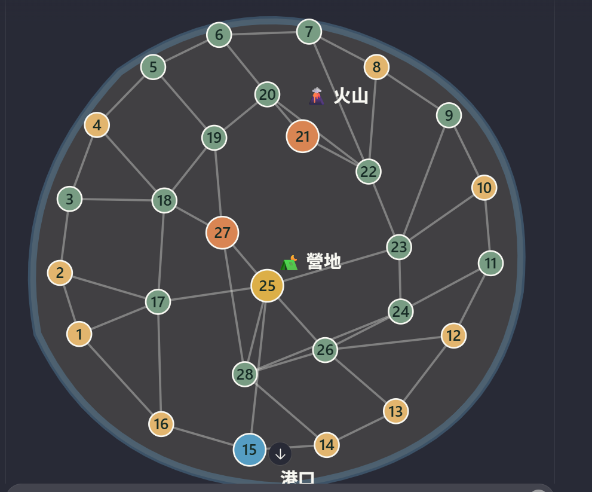

# 03A｜主島 28 Node 原圖重讀與正式連線表

**來源：使用者直接上傳的《28 Node 地圖草案》圖檔及同訊息分區文字。** 相較先前摘要，現在**可逐線核對拓樸**；圖上的數字是節點 ID，不是島民編號。

## 讀圖規則

- Node **1–16** 為完整閉合的外海岸道路環；**17–28** 為內陸及功能性地點。
- 道路為**無方向**的圖邊。線在非節點處交叉，不構成額外道路轉向或新節點；只有在圓形節點處可轉向。
- 港口 **15** 和中央營地 **25** 有一條**直接道路**（不是透過28）。
- 圖檔中的顏色：沙黃色＝海灘類、綠色＝一般地形、橘色＝特殊地點、藍色＝港口、黃色＝營地。顏色只作場景分類，不是額外移動限制。
- 下方 CSV 的座標僅是原圖 **991×823 畫素**上的*近似排版中心*，不代表世界距離或行動耗時。

## 節點類型與地點

| Node | 圖例類型 | 名稱（依圖示/分區文字） |
|---|---|---|
| 01 | 海灘類 | 未逐點確認 |
| 02 | 海灘類 | 未逐點確認 |
| 03 | 一般地形 | 未逐點確認 |
| 04 | 海灘類 | 未逐點確認 |
| 05 | 一般地形 | 未逐點確認 |
| 06 | 一般地形 | 北岸石堆 |
| 07 | 一般地形 | 北部海岸 |
| 08 | 海灘類 | 東北沙灘 |
| 09 | 一般地形 | 東岸森林 |
| 10 | 海灘類 | 東部沙灘 |
| 11 | 一般地形 | 未逐點確認 |
| 12 | 海灘類 | 未逐點確認 |
| 13 | 海灘類 | 未逐點確認 |
| 14 | 海灘類 | 未逐點確認 |
| 15 | 港口 | 港口 |
| 16 | 海灘類 | 未逐點確認 |
| 17 | 一般地形 | 西部森林 |
| 18 | 一般地形 | 空地 |
| 19 | 一般地形 | 石堆 |
| 20 | 一般地形 | 山路 |
| 21 | 特殊地點 | 火山入口 |
| 22 | 一般地形 | 東北石堆 |
| 23 | 一般地形 | 東部森林 |
| 24 | 一般地形 | 河流 |
| 25 | 中央營地 | 中央營地 |
| 26 | 一般地形 | 河岸空地 |
| 27 | 特殊地點 | 紀念碑谷 |
| 28 | 一般地形 | 內陸空地 |

**地名注意：**原訊息「01～05」只有四個集合描述，「11～16」只有四種描述，均**無法一對一落名**；故這些格的精確名稱不依圖色推測。06～10、17～28按原分組順序列出參考名稱，但其未在圓內逐一標註的名稱仍需保留`按群組順序對應`註記（見`island_nodes.csv`）。圖示明確確定的只有 15 港口、21 火山入口、25 營地、27 紀念碑谷。

## 完整雙向鄰接表（逐線轉錄）

| Node | 直接相鄰 Node | 度數 |
|---|---|---:|
| 01 | 02, 16, 17 | 3 |
| 02 | 01, 03, 17 | 3 |
| 03 | 02, 04, 18 | 3 |
| 04 | 03, 05, 18 | 3 |
| 05 | 04, 06, 19 | 3 |
| 06 | 05, 07, 20 | 3 |
| 07 | 06, 08, 22 | 3 |
| 08 | 07, 09, 22 | 3 |
| 09 | 08, 10, 23 | 3 |
| 10 | 09, 11, 23 | 3 |
| 11 | 10, 12, 24 | 3 |
| 12 | 11, 13, 26 | 3 |
| 13 | 12, 14, 26 | 3 |
| 14 | 13, 15, 28 | 3 |
| 15 | 14, 16, 25 | 3 |
| 16 | 01, 15, 17 | 3 |
| 17 | 01, 02, 16, 18, 25 | 5 |
| 18 | 03, 04, 17, 19, 27 | 5 |
| 19 | 05, 18, 20, 27 | 4 |
| 20 | 06, 19, 21, 22 | 4 |
| 21 | 20, 22 | 2 |
| 22 | 07, 08, 20, 21, 23 | 5 |
| 23 | 09, 10, 22, 24, 25 | 5 |
| 24 | 11, 23, 26, 28 | 4 |
| 25 | 15, 17, 23, 26, 27, 28 | 6 |
| 26 | 12, 13, 24, 25, 28 | 5 |
| 27 | 18, 19, 25, 28 | 4 |
| 28 | 14, 24, 25, 26, 27 | 5 |

## 資料表及校驗

- [`tables/island_nodes.csv`](tables/island_nodes.csv)：28列 Node，含視覺類型、名稱確定程度及原圖座標。
- [`tables/island_edges.csv`](tables/island_edges.csv)：51條唯一雙向邊。**雙向邊只存一列**，引擎載入後補雙向鄰接。
- [`tables/island_adjacency.csv`](tables/island_adjacency.csv)：28列清單，供人工重讀與測試。
- 外圈 16 邊完整；圖整體連通；15↔25 為直接相鄰；每個 Node 都有至少兩個直接鄰居。

## 原決議相容條件

- 地圖移動沿**一條邊**消耗 **3 T**，速度不降低費用；碰到視覺線段交叉時不能中途改向。
- 三個「椰子沙灘」仍各日生產1、最多3顆、自然庫存不過期；**目前原分區文字未確定三個椰子沙灘分別是哪三個 Node**，不可擅自配到1/12或8/10。
- 夜間岩石、河流、火山入口、釣魚站、紀念碑谷的具體觸發須依原場景規則；**圖沒有單獨標出所有事件觸發點**，不能因節點名稱擅自添加觸發。
- 本章只補**主島**圖，三層火山地牢各自的 A/B/C 分支路線不從這張圖推測。
